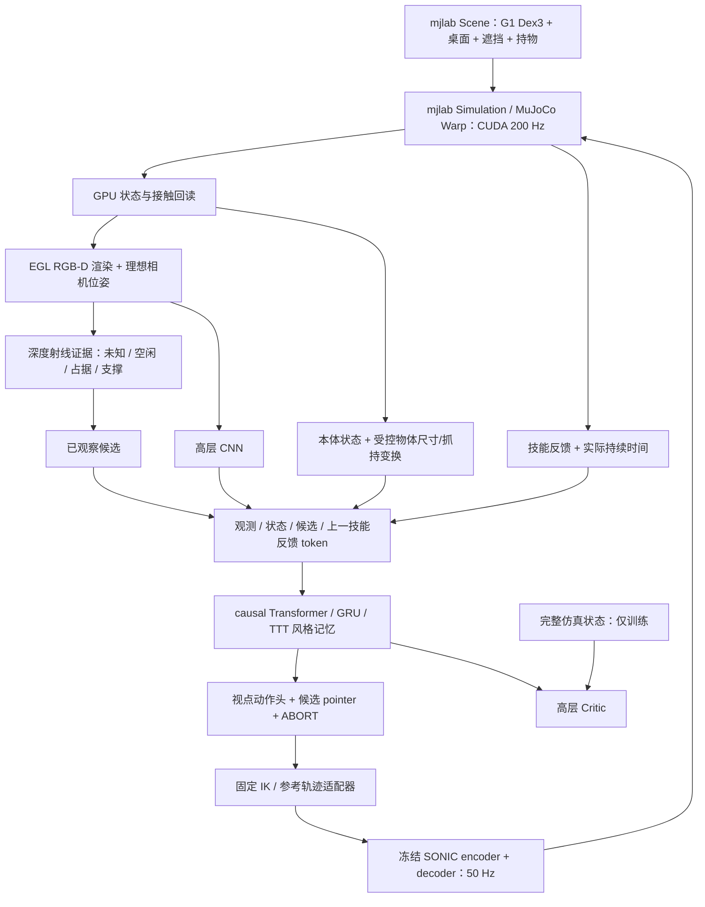

# RLExplore：mjlab + 冻结 SONIC + 主动放置高层 RL

代码在 4090 服务器 `/home/tcs/8t01/lhx/RLExplore`。当前主仿真后端为 **mjlab 1.5.0 / MuJoCo Warp**，物理通过 `mjlab.sim.Simulation.step()` 在 CUDA 上推进。机器人使用指定的 `/home/tcs/8t01/lhx/weightlifterc2p/src/assets/robots/unitree_g1_dex3/xmls/g1_dex3.xml`；不修改原机器人资产或 SONIC 工程。

当前实现方案中的 **A 级固定骨盆局部主动观察与放置**，包括 Transformer-PPO、GRU-PPO、反应式 PPO、实验性 TTT 风格记忆，以及深度证据地图、观察候选和放置技能。SONIC 的 encoder/decoder ONNX 始终冻结，只训练高层模块。

**本轮按要求只做简单测试，不启动 mjlab 训练或批量实验。** 测试记录见 `docs/validation.md`。旧 MuJoCo 后端日志保留在 `runs/`，不能作为 mjlab 的验收或实验结果。

## 系统架构



高层选择 9 个腰部 yaw/pitch 观察姿态、最多 16 个观察所得放置候选或 ABORT。技能根据合法目标生成 IK 与平滑参考，由 SONIC 输出身体控制；手指采用固定 PD。放置包含接近、下降、释放 weld、撤手和稳定支撑检查。

`mjlab_runtime.py` 负责真正的 GPU 物理推进、控制/释放同步以及 GPU 接触回读。CPU `MjData` 用于 ONNX 输入、IK、渲染和结果读取；主后端不调用 CPU `mj_step()`。当前 RGB-D 使用 GPU 状态回读后的 EGL 渲染，尚未接入 mjlab 原生批量 CameraSensor。

## 安装与简单测试

服务器上创建了项目专用 `.venv_mjlab`，通过 `.pth` 只读复用 `/home/tcs/1t01/envs/capylab/lib/python3.10/site-packages`。它提供兼容的 mjlab 1.5.0、MuJoCo 3.10.0、MuJoCo Warp 3.10.0.1、Warp 1.14.0、Torch 2.12.1、ONNX Runtime 1.23.2。没有往共享环境安装包。

```bash
cd /home/tcs/8t01/lhx/RLExplore

# 仅在需要重建项目环境时执行
bash scripts/setup.sh --reuse-server-runtimes

# 查看依赖、资产和 checkpoint 哈希
./scripts/run.sh doctor --set device=cuda:0

# 单次 smoke：4 个观察动作、真实 SONIC 推理和一次上层反向传播
MJLAB_WARP_QUIET=1 ./scripts/run.sh smoke --config configs/smoke.yaml

# 小规模单元/集成测试，不启动 PPO 训练或实验扫描
MJLAB_WARP_QUIET=1 ./scripts/python.sh -m unittest discover -s tests -v
```

默认 `simulator=mjlab`、`device=cuda`、`MUJOCO_GL=egl`。CUDA 不可用时明确报错，不回退 CPU 仿真。独立机器可用 `bash scripts/setup.sh --standard` 安装项目依赖，再覆盖 `asset_xml` 和 `sonic_dir`。SONIC 目录须已有 `model_encoder.onnx`、`model_decoder.onnx`、`observation_config.yaml`；不自动下载权重。

## 高层代码接口

`PlacementEnv` 提供宏动作 Gym 接口，其内部为 mjlab `Scene` 与 `Simulation`，尚未改成 `ManagerBasedRlEnv` 或多环境向量化 runner。每个物理 reset 会重新上传随机化后的模型并创建 CUDA 图，避免 CPU 参数变了、GPU 碰撞边界仍旧的错误。这是先验证单环境链路的实现，尚未优化训练吞吐。

网络共用 RGB-D 编码、94 维状态、14 维候选特征和 pointer 动作头。Transformer 使用 causal mask；GRU 和 TTT 使用同一有限历史窗口。PPO 更新时重算对应的完整合法上下文，episode reset 清空历史；使用实际动作耗时的折扣与 GAE，区分 terminal 和 timeout。

Actor 只访问 RGB-D、本体/相机位姿、受控已知物体尺寸及抓持变换、历史和反馈。地图与候选不读隐藏障碍坐标、simulator ID 或完整几何。特权真值单独用于训练 Critic，Critic 对 Actor 共享特征 stop-gradient；actor-only 评估不调用 `privileged_state()`。

## 后续训练入口（本轮未运行）

```bash
# 单次训练入口
./scripts/run.sh train --config configs/default.yaml --set backbone=transformer run_dir=runs/mjlab_transformer

# GRU / TTT 风格变体
./scripts/run.sh train --config configs/default.yaml --set backbone=gru run_dir=runs/mjlab_gru
./scripts/run.sh train --config configs/default.yaml --set backbone=ttt run_dir=runs/mjlab_ttt

# 恢复优化器，物理环境从新 episode 开始；updates 是累计目标更新数
./scripts/run.sh train --config runs/mjlab_transformer/config.yaml --resume runs/mjlab_transformer/last.pt --set updates=200

# actor-only 评估
./scripts/run.sh eval --config runs/mjlab_transformer/config.yaml --checkpoint runs/mjlab_transformer/last.pt --episodes 100 --set split=test --output runs/mjlab_transformer/eval_test.json

# 仅生成计划命令，不启动实验
./scripts/run.sh manifest --output experiments/manifest.json
```

checkpoint 保存配置、优化器、SONIC 哈希和 simulator 信息。旧 CPU MuJoCo checkpoint 不允许直接恢复为 mjlab 实验，以免混淆后端与结果。默认 100 × 64 次决策只是起始预算，不代表足以收敛。

## 实验实现与边界

已实现 E0 无遮挡执行、E1 初始视野外支撑面、E2 局部遮挡、E3 同布局物体尺寸、E7 技能超时、E9 深度/位姿噪声，以及 `use_map`、`use_object`、`use_feedback`、`privileged_critic`、`history_length` 消融开关。设计表见 `docs/experiments.md`，这些功能的存在不代表已经完成实验。

- 当前骨盆固定，没有验证行走、平衡、床底搜寻或开柜技能。
- 初始持物是理想固定抓持；释放后为自由刚体接触，没有训练或验证现实 Dex3 抓握。
- 相机位姿与物体尺寸是受控仿真输入，没有实机估计器。
- TTT 是可微快权重回归记忆实验层，不是原 TTT 论文完整复现，也不是部署时 PPO 更新。
- `scan` 和 `geometry` 是固定扫描与简单几何规则，尚无强 NBV/ActPerMoMa 复现。
- train/val/test 使用不相交种子区间，不等同于独立房型/资产泛化评测。
- 旧后端只通过显式 `simulator=mujoco_debug device=cpu` 进入；`backend=pd_debug` 也是调试控制器，均不能算 mjlab + SONIC 主结果。
- 当前没有 mjlab 上的收敛训练或多种子性能结论。

## 文件索引

`physics.py`：mjlab 场景、机器人资产、IK、放置；`mjlab_runtime.py`：CUDA 物理执行与状态/接触同步；`sonic.py`：冻结 ONNX 接口；`memory.py`：观测证据地图；`env.py`：宏动作与奖励；`model.py`：四种高层网络；`history.py`：合法历史；`ppo.py`：训练/恢复/评估；`experiments.py`：仅生成实验计划。
